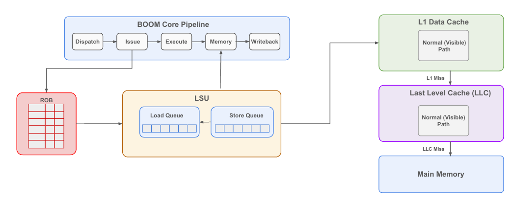
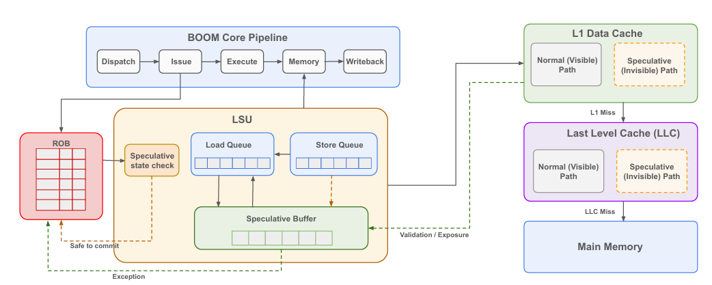
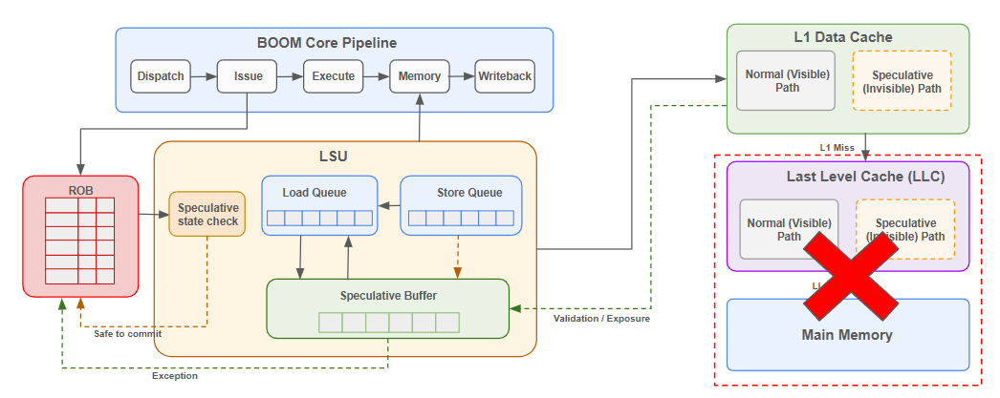

# InvisiBOOM

**Making Speculative Execution Invisible in the Cache Hierarchy — implemented on the BOOM RISC-V core**

---

## Table of Contents

- [Background](#background)
- [InvisiSpec](#invisispec)
- [InvisiSpec Architecture](#invisispec-architecture)
- [BOOM Load Operation](#boom-load-operation)
- [InvisiBOOM Implementation](#invisiboom-implementation)
  - [Key Concepts](#key-concepts)
  - [Speculative Buffer](#speculative-buffer)
  - [Visibility, Exposure & Validation](#visibility-exposure--validation)
  - [Current Implementation Flow](#current-implementation-flow)
- [Speculative Miss Handling in L1 Cache](#speculative-miss-handling-in-l1-cache)
- [Results](#results)
- [Future Optimizations](#future-optimizations)
- [Related Work](#related-work)

---

## Background

Speculative execution improves CPU performance, but it comes with a security cost:

- Speculative loads can become **transient instructions** — instructions that execute but are never meant to commit.
- These transient instructions still leave **observable changes in the cache hierarchy**, enabling **microarchitectural side channels**.
- Attackers exploit this to leak sensitive data:
  - **Meltdown** — relies on generating exceptions.
  - **Spectre** — requires **no exceptions at all**, making it harder to mitigate.

### Existing Fixes

| Attack | Mitigation | Drawback |
|---|---|---|
| Meltdown | Mark data loaded by an exception-triggering load as unreadable | Effective, low overhead |
| Spectre | Disable all speculation | **High performance overhead** |

This motivates a solution that keeps speculation enabled while hiding its effects from the cache hierarchy — **InvisiSpec**.

---

## InvisiSpec

InvisiSpec (Yan et al., MICRO 2018) makes **Unsafe Speculative Loads (USLs)** invisible in the data cache hierarchy until they become safe.

It defines two protection models:

| Model | Protects against |
|---|---|
| **V1** | Spectre-like attacks based on **branch speculation** |
| **V2** | Futuristic attacks where **any speculative load** may pose a threat |

This project implements **Model V2** — the stronger, more general model.

**Core mechanism:**
- USLs read data into a **speculative buffer**, without modifying the cache hierarchy.
- Once a load becomes **safe**, InvisiSpec exposes it to the rest of the memory system.

---

## InvisiSpec Architecture

The core idea is to split each cache level into two logical paths:

- **Normal (Visible) Path** — used by non-speculative memory accesses.
- **Speculative (Invisible) Path** — used by speculative loads; does not alter cache state.

A **Validation / Exposure** feedback path connects the cache hierarchy back to the core, confirming whether speculative data is still correct before it is committed.

---

## BOOM Load Operation

### Unmodified BOOM core pipeline.

Standard load handling in BOOM:

1. The LSU places the load request in the **load queue**.
2. **L1 D-Cache lookup** is performed.
3. **Cache hit** → load data directly from L1.
4. **Cache miss** →
   - Allocate an MSHR in the L1 cache.
   - Send an `Acquire` request to the L2 cache.
   - Refill the cache line.
   - Update cache metadata and data arrays.

⚠️ **Problem:** All loads — including speculative ones — are treated identically. Transient loads therefore change cache state and **open the door to side-channel attacks**.

---

## InvisiBOOM Implementation

**Main idea:** Speculative loads must not modify visible cache state until they are no longer speculative — i.e., until they reach the **Point of No Return (PNR)**.

InvisiBOOM extends the BOOM LSU with:
- A **Speculative state check** stage between the ROB and the Load Queue.
- A **Speculative Buffer** sitting alongside the Load Queue.
- A **Validation / Exposure** feedback path from the cache hierarchy back into the LSU and ROB.
- An **Exception / Safe-to-commit** signal path from the Speculative state check back to the ROB.

### Key Concepts

#### Speculative Load Status

| Status | Meaning |
|---|---|
| **Normal** | Not speculative |
| **Exposure** | Speculativie and not squashable |
| **Validation** | Speculative and Squashable |

> Whether a load needs **Validation** or **Exposure** depends on the target **memory consistency model** (TSO / RC / RVWMO).

#### Speculative Buffer

- Holds the data of in-flight speculative loads.
- Has a **one-to-one mapping** with Load Queue entries.
- Speculative loads read data into the buffer **without updating the cache hierarchy**.
- Functional units consume data directly from this buffer.

#### Visibility, Exposure & Validation

- **Visibility point:** the ROB's **PNR (Point of No Return)**.
- **Load Exposure:** informs the cache hierarchy about previously speculative data once it's confirmed safe.
- **Load Validation:** compares the speculatively loaded data against the latest memory value.
  - **Match** → `clear_unsafe` + commit normally.
  - **Mismatch** → `mini_exception` triggered + **ROB flush**.

### Current Implementation Flow

High-level flow for a new load entering the ROB:

1. Determine if the load is **speculative**.
   - If **not speculative** → `invisi_state = invisi_none` → normal load procedure.
   - If **speculative** → check whether older loads exist in the ROB.
     - Older loads present → `invisi_state = invisi_validation`
     - No older loads → `invisi_state = invisi_exposure`
2. Perform a **speculative memory access**.
   - May be killed/forwarded, or NACKed and retried depending on L1 hit/miss state.
3. On success, data is stored in the **Speculative Buffer**, and state becomes `validation_done` / `exposure_done`.
4. Once the entry reaches the **ROB head**:
   - Run **Load Validation Memory Access** or **Load Exposure Memory Access** depending on state.
   - For **Load Validation Memory Access** compare data in the speculative buffer against freshly fetched data.
     - **Data mismatch** → `Load Mini Exception` → **ROB flush**.
5. `invisi_state = invisi_complete`, ROB updated, load completes successfully.

---

## Speculative Miss Handling in L1 Cache

**Ideal approach:** request missing data directly from L2 on a speculative miss — but this requires modifications to the **TileLink protocol**.

**Current policy (implemented):**
- Do **not** request data from L2 on a speculative L1 miss.
- **Wait** until the instruction becomes non-speculative.
- **Then** perform a normal memory access.

This is a conservative but correctness-preserving simplification, at the cost of extra latency for speculative loads that miss in L1.

---

## Results

| Test | Status |
|---|---|
| [`riscv-tests` / benchmarks](https://github.com/riscv-software-src/riscv-tests) | ✅ Passed |
| [`riscv-torture` (randomized stress-test generator)](https://github.com/ucb-bar/riscv-torture) | ✅ Passed |
| Linux boot | ❌ Not yet successful (kernel panic) — `[TODO]` retest on latest version |

---

## Future Optimizations

- **Handle L1 cache misses for speculative loads** (i.e., implement the "ideal" TileLink-based speculative refill path).
- **Reduce the number of validations** by transforming validations into exposures where the memory consistency policy allows it.
- **Extend threat model coverage** for adversarial receiver/victim program placement:

| Scenario | Status |
|---|---|
| Same thread | ✅ Currently supported |
| Cross-core | ❌ Not currently supported |
| SMT | ❌ Not supported (BOOM itself has no SMT support) |

---

## Related Work

Other defenses against speculative (Spectre-class) side-channel attacks:

- Kiriansky et al. — *SafeSpec: Banishing the Spectre of a Meltdown with Leakage-Free Speculation* (ISCA, 2018)
- Yan et al. — *InvisiSpec: Making Speculative Execution Invisible in the Cache Hierarchy* (MICRO, 2018)
- Wang et al. — *DAWG: A Defense Against Cache Timing Attacks in Speculative Execution Processors* (MICRO, 2018)

---
